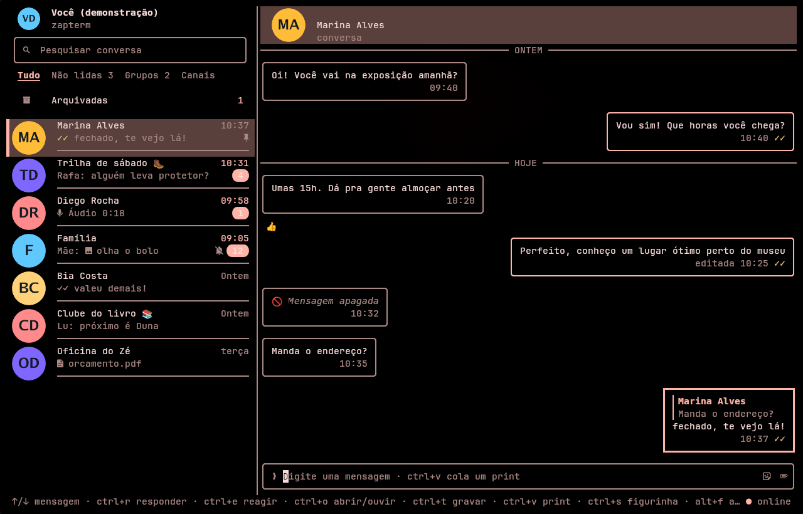

# zapterm

WhatsApp no terminal. Lista de conversas, balões, fotos e figurinhas
desenhadas no próprio terminal (kitty), áudio, notificações e atalhos de
teclado, com o visual do WhatsApp Web e as cores do seu tema.



> **Aviso:** o zapterm é um cliente **não oficial**. Ele se conecta como um
> "aparelho conectado", do mesmo jeito que o WhatsApp Web, pela biblioteca
> [whatsmeow](https://github.com/tulir/whatsmeow). Usar cliente não oficial
> viola os Termos de Serviço do WhatsApp, e a Meta pode banir o número.
> Com uso pessoal normal o risco é baixo, mas não é zero. Não use para
> mandar mensagem em massa nem para automação.

## O que ele faz

- **Conversas:** lista com fotos de perfil, fixados, não lidas, filtros
  (Tudo · Não lidas · Grupos · Canais · ☰ as listas do celular, como
  Favoritas), arquivadas e busca, inclusive no
  texto das mensagens (sem diferenciar acento e maiúscula), pulando para a
  mensagem achada. Filtros na busca: `tipo:pdf`, `tipo:foto`, `tipo:link`,
  `tipo:enquete`…, `data:12/10`, `data:ontem`, `antes:1/10`, `depois:1/9`
  (juntos ou com texto: `contrato tipo:pdf depois:1/9`).
- **Mensagens:** responder com citação, reagir (❤️ 👍 😂 😮 😢 🙏),
  copiar, editar, apagar para todos e encaminhar; formatação do WhatsApp
  (*negrito*, _itálico_, ~riscado~, `código`) e links clicáveis;
  mensagens editadas e apagadas, tracinhos de entregue e lido,
  "digitando…", online e visto por último.
- **Grupos:** marcar alguém com `@` (lista de participantes enquanto você
  digita) e ver as menções em destaque; menção a você notifica mesmo em
  grupo silenciado.
- **Organizar:** fixar, arquivar, silenciar e marcar como lida pelo
  próprio zapterm (sincroniza com o celular); nova conversa digitando um
  número na busca.
- **Mídia no terminal:** fotos, figurinhas (inclusive animadas) e
  miniaturas de vídeo dentro do balão, pelo protocolo gráfico do kitty.
  Foto abre em tela cheia; vídeo e PDF abrem no seu player e leitor.
- **Enviar:** texto, print colado com `ctrl+v`, qualquer arquivo pelo
  seletor nativo (foto, vídeo, áudio, documento), suas figurinhas
  favoritas do celular e mensagem de voz gravada no microfone.
- **Notificações** com a foto do contato, respeitando chats silenciados e
  arquivados e sem avisar do chat que você está vendo. Clicar abre o chat
  no zapterm (ou abre o zapterm, se estiver fechado); servidores com
  resposta embutida (Noctalia, Plasma) deixam responder pela própria
  notificação.
- **Barra do Noctalia:** widget com o número de conversas não lidas, que
  abre o zapterm no clique ([instruções](noctalia/zapterm/README.md)).
  Fora do Noctalia, `zapterm unread --json` dá o mesmo resumo para outras
  barras.
- **Comunidades:** os grupos aparecem como "Comunidade › Grupo" (o de
  avisos como "› Avisos") e ficam juntos no filtro Grupos; `alt+o` no
  perfil lista os grupos da comunidade.
- **Perfil** (clique no cabeçalho ou `alt+i`): foto grande, número e
  recado do contato, ou descrição e participantes do grupo.
- **Participantes** (perfil do grupo): `↓` escolhe, `enter` abre conversar
  e, se você é admin, tornar/tirar admin e remover; `alt+c` abre o link de
  convite: copiar, mostrar o QR, redefinir (admin).
- **Criar grupo** (`alt+y` → Novo grupo): `enter` marca as pessoas na
  busca, `alt+enter` pede o nome. **Administrar** (`alt+e` no perfil do
  grupo): nome, descrição, foto, adicionar pelo telefone, só admins mandam
  mensagens / mudam os dados / adicionam, aprovar quem entra pelo link e
  os pedidos pendentes.
- **Link `chat.whatsapp.com`** recebido: `ctrl+o` mostra o grupo (nome,
  participantes) e oferece entrar.
- **Admin** apaga para todos a mensagem de um membro (`alt+d`).
- **Mídia, links e docs** (`enter` no perfil): abas Fotos, Vídeos, Docs,
  Links e Áudios, separadas por mês; `ctrl+g` mostra o item na conversa.
  Mídia antiga sem prévia é pedida de novo ao seu celular.
- **Eu** (`alt+y` ou clique na sua foto no topo): uma tela com a sua foto,
  nome, número e recado e as opções: trocar nome e recado, privacidade da
  conta (visto por último, online, foto, status, confirmação de leitura, quem
  te põe em grupos, chamadas de desconhecidos), novo grupo, novo canal,
  explorar canais e **Desconectar**. Desconectar tira este computador de
  *Aparelhos conectados* no celular e volta para a tela de login; as
  mensagens e mídias guardadas aqui ficam. Se for o celular que desconecta o
  zapterm, a tela de login avisa.
- **Transcrição de áudio** (opcional, no seu computador): com o
  [whisper.cpp](https://github.com/ggerganov/whisper.cpp) instalado e um
  modelo `ggml-*.bin` em `~/.local/share/zapterm/whisper/`, o menu da
  mensagem de áudio ganha "Transcrever" e o texto fica embaixo do áudio.
  Nada sai da sua máquina (`[transcription]` no config).
- **Canais:** `alt+y` → Explorar canais mostra os recomendados (filtra
  enquanto digita; colar um link `whatsapp.com/channel/…` + `enter` acha
  aquele canal) e segue; `alt+y` → Novo canal cria um seu. O diretório
  usa uma API interna do WhatsApp e pode parar de funcionar.
- **Status** (`alt+r`): quem postou nas últimas 24 h, os não vistos
  primeiro; `enter` vê (←/→ andam), `r` responde no privado citando o
  status, `n` publica um status de texto. O "visto" respeita
  `read_receipts` do config.
- **Central de mídia** (`alt+g`): as mesmas abas com tudo de todas as
  conversas, dizendo de onde é cada item; `ctrl+g` abre a conversa nele.

## Como funciona

Dois processos: um **daemon** fica conectado ao WhatsApp o tempo todo
(notificações chegam mesmo com a tela fechada) e guarda conversas num
SQLite local. A **TUI** fala com ele por um socket Unix e sobe o daemon
sozinha se ele não estiver rodando.

Seus dados ficam só na sua máquina:

| O quê | Onde |
|---|---|
| Sessão do WhatsApp e conversas | `~/.local/share/zapterm/` |
| Fotos, áudios, figurinhas e avatares baixados (pode apagar) | `~/.cache/zapterm/` |
| Log do daemon | `~/.local/share/zapterm/daemon.log` |

Privacidade: o daemon só aparece **online** para os outros enquanto a TUI
está aberta e com a janela em foco num chat, como o WhatsApp Web. Abrir um
chat marca as mensagens como lidas, como no app.

## Requisitos

Feito e testado no Linux (Wayland, Sway), no terminal **kitty**. No X11
(Cinnamon, GNOME, KDE…) ele também funciona: copiar e colar usam o `xclip`,
e a janela vem do terminal que o sistema tiver. Os pacotes `.deb`, `.rpm` e
do Arch já recomendam tudo o que está abaixo, inclusive o kitty e o xclip.

| Para | Precisa de |
|---|---|
| Fotos e figurinhas no terminal | kitty (em outro terminal, como o gnome-terminal, elas viram texto) |
| Ícones | uma [Nerd Font](https://www.nerdfonts.com) (`ZAPTERM_NERDFONT=0` troca por texto) |
| Áudio (ouvir e gravar) | GStreamer com os plugins base, good e de Opus; PipeWire ou PulseAudio |
| Copiar e colar (inclusive print) | `wl-clipboard` no Wayland, `xclip` no X11 |
| Anexar arquivo | `xdg-desktop-portal` com um backend (gtk, gnome, kde…) |
| Notificações | um servidor de notificação no D-Bus (mako, dunst, swaync, o do Cinnamon…); o zapterm fala direto com ele, não usa o `notify-send` |
| Transcrever áudio (opcional) | `whisper-cli` do whisper.cpp e um modelo ggml |
| Vídeo e PDF | mpv/vlc/celluloid e zathura/sioyek/evince (usa o primeiro instalado) |

O binário é estático (o SQLite não usa cgo): não precisa de compilador C
nem de nada instalado só para abrir. O resto da tabela é o que liga cada
recurso; `zapterm doctor` confere o que o seu sistema tem e diz o pacote do
que falta no Arch, no Debian/Ubuntu e no Fedora.

## Instalação

**Ubuntu, Linux Mint, Debian** (sem digitar comando nenhum):

1. Na página de [Releases](https://github.com/arthurhmarinho/zapterm/releases),
   baixe o `.deb` do seu computador (`amd64` na maioria; `arm64` em Raspberry
   Pi e similares).
2. Dê dois cliques nele e clique em **Instalar**.
3. Abra o **zapterm** pelo menu de aplicativos (em Rede ou Internet).

O pacote recomenda o que o zapterm usa (kitty, GStreamer, xclip, mpv…), e o
instalador costuma trazer tudo junto; se faltar algo, `zapterm doctor` diz o
quê. Ele também registra o repositório do zapterm no apt. Por isso as **atualizações chegam
pelo Gerenciador de Atualizações**, junto com as do resto do sistema, sem
você baixar nada de novo. Pelo terminal dá o mesmo:
`sudo apt install ./zapterm_*.deb` na primeira vez e
`sudo apt update && sudo apt upgrade` depois.

**Fedora** (e outras com rpm): baixe o `.rpm` em Releases e instale com
`sudo dnf install ./zapterm*.rpm`. Para atualizar, baixe o novo (ou use o
`install.sh` abaixo).

**Arch**: `yay -S zapterm-bin` (quando o pacote estiver no AUR) ou o
`install.sh` abaixo.

**Qualquer distro** (baixa o binário da última versão, confere o sha256 e
instala em `~/.local/bin`; `ZAPTERM_BIN=/outra/pasta` muda o destino):

```sh
curl -fsSL https://raw.githubusercontent.com/arthurhmarinho/zapterm/main/install.sh | sh
```

**Pelo Go** (só precisa do Go 1.26 ou mais novo, sem compilador C):

```sh
go install github.com/arthurhmarinho/zapterm/cmd/zapterm@latest
```

O binário vai para `~/go/bin` (ou o `GOBIN`). Se `zapterm` não for
encontrado, ponha a pasta em que ele foi instalado no PATH. No fish:

```fish
fish_add_path -g $HOME/go/bin
```

No bash/zsh: `export PATH="$HOME/go/bin:$PATH"` no `~/.bashrc` ou `~/.zshrc`.

Depois de instalar, rode:

```sh
zapterm doctor
```

Ele lista o que está ok e o que falta (GStreamer, xclip ou wl-clipboard,
servidor de notificação…), com o pacote de cada distro. Não muda nada no
sistema.

### Atualizar

- **.deb:** pelo Gerenciador de Atualizações (ou `sudo apt update && sudo apt
  upgrade`). Se você removeu o repositório do zapterm do apt, baixe o `.deb`
  novo e instale por cima.
- **Os outros métodos:** repita o que você usou (`yay -Syu`, o `curl … | sh`,
  o pacote novo ou o `go install`).

O daemon que estava rodando é trocado pelo da versão nova sozinho, na
próxima vez que você abrir o zapterm (o `install.sh` já o reinicia na hora;
ou rode `zapterm restart`). Uma TUI que estava aberta durante a atualização
avisa para ser fechada e aberta de novo. `zapterm version` mostra a versão
em uso.

## Primeiro uso

```sh
zapterm
```

Sem sessão, a própria TUI mostra a tela de login: escaneie o QR code no
celular (**WhatsApp → Aparelhos conectados → Conectar um aparelho**) ou
aperte `tab` e digite o número para receber um código de 8 letras, que vai
em **Conectar com número de telefone**. O QR se renova sozinho. Pareou, a
lista aparece e o histórico chega nos próximos minutos.

Se preferir parear fora da TUI, `zapterm login` mostra o QR no terminal
(`zapterm login --telefone 5584999999999` mostra o código de 8 letras) e
fica rodando: deixe até o log parar de mostrar `history sync`. Depois:

```sh
zapterm
```

Trocar de conta não mistura as conversas: ao parear um número diferente do
anterior, o banco antigo vira `~/.local/share/zapterm/zapterm-<número>.db` e
o zapterm começa vazio.

Para o daemon subir junto com o Sway (e as notificações chegarem sem
abrir a TUI), no `~/.config/sway/config`:

```
exec zapterm daemon
```

O Sway não lê o PATH do shell: se ele não achar o `zapterm`, troque pelo
caminho completo que `command -v zapterm` mostra.

Para ver sem conta nenhuma, com conversas inventadas:

```sh
zapterm demo          # a TUI inteira, com dados inventados
zapterm demo --login  # começando pela tela de login (QR de mentira)
```

## Atalhos

O campo de escrita fica sempre ativo, como no Claude Code: é só digitar.
O mouse também funciona (clique, botão direito para o menu da mensagem ou do chat, roda).

| Tecla | Faz |
|---|---|
| `↑` `↓` | chats na lista, ou mensagens na conversa |
| `tab` | troca entre lista e conversa |
| `enter` | envia (com o campo vazio na lista, abre o chat) |
| `shift+enter` | nova linha |
| `ctrl+p` | pesquisar conversa (ou digite um número para conversa nova) |
| `ctrl+f` | procurar nesta conversa: enter/↑ vai ao mais antigo, ↓ ao mais novo |
| `alt+g` | central de mídia: fotos, vídeos, docs, links e áudios de todas as conversas |
| `alt+↑` / `alt+↓` | abre a conversa de cima / de baixo na lista |
| `alt+n` | abre a próxima conversa com mensagens não lidas |
| `alt+1`…`alt+5`, `alt+a` | filtros (Tudo, Não lidas, Grupos, Canais, ★ favoritas) e arquivadas |
| `alt+6` | ☰ listas do celular (Favoritas e as suas): escolhe qual filtrar; o menu do chat põe e tira a conversa delas |
| `ctrl+r` | responder a mensagem selecionada |
| `ctrl+e` | reagir: 1–6 as rápidas, ou digite o nome de qualquer emoji (`fogo` → 🔥) |
| `ctrl+↑` | editar a sua última mensagem |
| `:nome` | emoji pelo nome no campo: `:kkk` → 😂, `:cora` → ❤️ (português ou inglês) |
| `ctrl+o` | abrir foto, vídeo, documento, link, ou tocar áudio; na enquete vota, no evento responde Vou / Talvez / Não vou |
| `alt+c` `alt+e` | copiar / editar (sua, até 15 min) |
| `@` em grupo | marca alguém (autocompleta); `@todos` marca todo mundo (em grupo com mais de 32, só admin) |
| `alt+.` | menu da mensagem: responder, responder em privado, reagir, abrir, copiar, editar, encaminhar, apagar (ou botão direito) |
| `alt+d` | apagar: pergunta se é para você ou para todos; `alt+z` desfaz o "para mim" por 5 s |
| `alt+w` | encaminhar: na busca, `enter` marca até 5 conversas e `alt+w` envia |
| `shift+↑` / `shift+↓` | seleciona várias mensagens; aí `alt+c` copia todas, `alt+w` encaminha, `alt+d` apaga para você |
| `alt+p` | pula para a mensagem fixada (alterna se houver mais de uma); fixar e desafixar ficam no menu da mensagem |
| `alt+s` | favoritar / desfavoritar a mensagem (sincroniza com o celular); o filtro **★** (`alt+5`) lista as favoritas |
| `alt+m` | menu do chat: fixar, arquivar, silenciar, marcar como (não) lida, mensagens temporárias, bloquear, sair do grupo, limpar (guarda as favoritas) e apagar conversa (ou botão direito) |
| `alt+i` | perfil do contato ou grupo (ou clique no cabeçalho) |
| `alt+r` | status: ver, responder (`r`) e publicar um de texto (`n`) |
| `alt+y` | Eu: sua foto, nome, recado, privacidade, novo grupo/canal e desconectar (ou clique na sua foto no topo) |
| `@` | marcar alguém num grupo |
| `ctrl+v` | colar print para enviar |
| `alt+f` ou o clipe | menu de anexar: foto ou vídeo, arquivo, figurinha, enquete, evento, contato |
| painel de envio | `alt+q` HD · `alt+t` como figurinha · `alt+o` visualização única; o seletor aceita vários arquivos, e arrastar arquivos para o kitty também anexa |
| `/` no campo vazio | os mesmos como comandos: `/foto`, `/arquivo`, `/figurinha`, `/enquete`, `/evento`, `/contato` (`esc` manda o texto como está) |
| `ctrl+s` | figurinhas (favoritas do celular; `tab` troca para as recentes) |
| `ctrl+t` | gravar mensagem de voz (`p` pausa e continua; espaço para e deixa ouvir antes de enviar) |
| `ctrl+o` no áudio | toca / pausa (com mpv instalado; sem ele, toca do começo ao fim) |
| `alt+v` | velocidade do áudio: 1×, 1,5×, 2× |
| `←` / `→` | com áudio tocando e o campo vazio, volta / avança 5 s |
| `alt+x` | para o áudio |
| `pgup` `pgdn` | rolar a conversa |
| `esc` | cancela o que estiver aberto |
| `ctrl+c` | limpa o campo; vazio, duas vezes, sai |
| `F1` | todos os atalhos (os atalhos podem ser trocados no [config](#configuração)) |

## Configuração

```sh
zapterm config
```

Cria `~/.config/zapterm/config.toml` todo comentado, com os valores padrão,
e mostra o caminho. Sem o arquivo, vale o padrão. Dá para:

- **[privacy]**: não mandar o tracinho azul ao abrir um chat, não aparecer
  online nem "digitando…", notificação sem o texto da mensagem, desligar
  notificações, não buscar a prévia dos links que você envia
  (`link_previews`: para montá-la o zapterm abre a página do seu
  computador);
- **[keys]**: trocar qualquer atalho (a ajuda e o rodapé acompanham);
- **[colors]**: cores do destaque, dos balões, dos painéis (número ANSI ou
  hex);
- **[apps]**: programa para vídeo, PDF, imagem e links;
- **[interface]**: imagens, ícones da Nerd Font, largura da lista.

Mudanças valem ao reabrir o zapterm; as de privacidade também pedem
reiniciar o daemon (`zapterm restart`).

## Limitações

- Chamadas de voz e vídeo não são atendidas pelo zapterm (atenda no
  celular); dá para recusar (`ctrl+o` na linha ou "Recusar" na
  notificação) e a conversa mostra se foi atendida, recusada ou perdida.
- Status (stories) ficam de fora.
- Mídia, citações e reações das mensagens que vieram no pareamento (o
  histórico inicial) não estão disponíveis; só as que chegam depois.
- Figurinhas favoritas antigas costumam ter expirado no servidor do
  WhatsApp (o celular guarda cópia local); só as que ainda existem lá, ou
  que passaram por uma conversa, aparecem.
- Em grupo, o tracinho azul aparece quando pelo menos uma pessoa leu.

## Comandos de depuração

```sh
zapterm chats              # lista os chats
zapterm msgs <jid> [n]     # últimas mensagens de um chat
zapterm tail               # eventos ao vivo
zapterm media <jid> <id>   # baixa a mídia de uma mensagem
```

## Licença

[GPL-3.0](LICENSE). Usa o [whatsmeow](https://github.com/tulir/whatsmeow)
(MPL-2.0) e o [Bubble Tea](https://github.com/charmbracelet/bubbletea)
(MIT).

Os nomes dos emojis (`internal/tui/emoji.tsv`) vêm do
[CLDR](https://cldr.unicode.org/) e da lista `emoji-test.txt` do Unicode,
© Unicode, Inc., sob a [Licença Unicode v3](https://www.unicode.org/license.txt).
